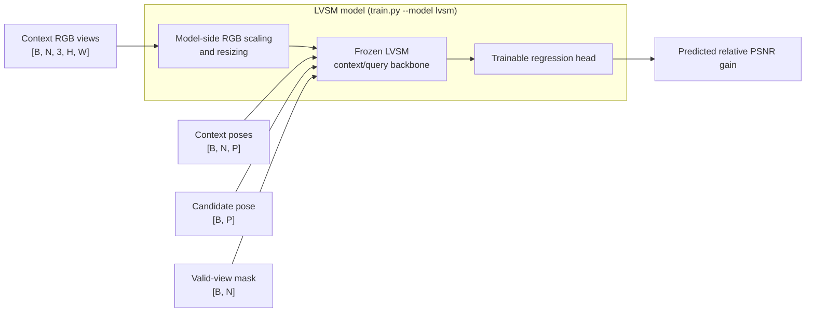
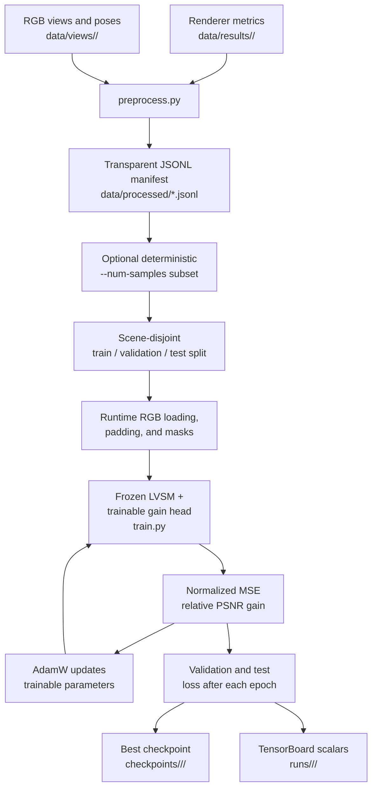

# Reconstruction Gain Predictor

The predictor estimates relative PSNR gain for adding a candidate camera pose:

```text
(candidate PSNR - base PSNR) / abs(base PSNR)
```

The model receives the existing context RGB views and their poses plus the
candidate pose. Candidate RGB is never used because it is unavailable at
decision time.

## Model architecture

The LVSM model uses the following inputs to predict one normalized scalar:



The candidate image is intentionally absent from both paths: prediction must
be possible before the candidate view is captured. During training, the
regression head learns from the ground-truth relative gain in the JSONL
manifest.

The valid-view mask identifies real context views versus padding when samples
contain different numbers of views. Images are batched as
`[batch, max_views, 3, H, W]`, with a corresponding mask shaped
`[batch, max_views]`; for example, `[1, 1, 1, 0, 0]` means that only the first
three views are real. The model uses this mask so padded slots do not affect
the pooled context representation.

## Repository structure

The project expects renderer outputs and view data under `data/`. Processed
JSONL manifests are generated once and then consumed by training and
evaluation:

```text
Reconstruction-Gain-Predictor/
├── data/
│   ├── results/
│   │   └── <scene>/results.json
│   ├── views/
│   │   └── <scene>/
│   │       ├── global_transforms/transforms_train.json
│   │       └── train/*.png or *.jpg
│   ├── processed/*.jsonl
│   └── splits/*.json                 # optional
├── preprocess.py
├── train.py
├── debug_train.py
├── inference.py
├── evaluate.py
├── model.py
├── dataset.py
├── tests/
├── runs/<model>/<timestamp>/
├── checkpoints/<model>/<timestamp>/
└── README.md
```

Each scene must have matching directories under `data/results/<scene>/` and
`data/views/<scene>/`. The results provide the base/candidate metrics, while
the views provide the camera transforms and referenced RGB images. The
`preprocess.py` command combines them into a manifest under
`data/processed/`; training does not require reconstruction assets.

## Training workflow



The same JSONL manifest can contain multiple scenes. Splitting happens at the
scene level to prevent records from one object appearing in both training and
evaluation. A one-scene run is useful for a pipeline or overfitting smoke test,
but is not a generalization measurement.

## Usage workflow

### 1. Preprocess once

Run this after renderer views and metric results exist:

```bash
cd Reconstruction-Gain-Predictor
../.venv/bin/python preprocess.py \
  --results-root data/results \
  --views-root data/views \
  --output data/processed/table.jsonl \
```

This creates one transparent JSONL dataset. It contains, per base/candidate
sample:

- paths to ordinary RGB context images;
- context camera poses;
- candidate camera pose;
- relative PSNR gain, base PSNR, and candidate PSNR;
- scene, experiment, and candidate identifiers.

It does not contain reconstruction paths or require reconstruction files.
The source folders are read during training as well. The model performs
conversion to tensors, scaling, and resizing before the backbone. The JSONL
dataset is stored wherever `--output` points; `data/processed/` is the
recommended project-local location.

For a one-sample debug dataset, add `--limit 1`.

### 2. Debug the pipeline with the toy CNN

`debug_train.py` uses the same processed-dataset format and training loop as
normal training, but forces CPU, the small CNN, and batch size one:

```bash
../.venv/bin/python debug_train.py \
  --dataset data/processed/table.jsonl \
  --num-samples 1 \
  --epochs 10
```

Both `train.py` and `debug_train.py` accept `--num-samples N`. Records are
selected deterministically in round-robin order across scenes, so a subset
does not accidentally contain only the first object's records. The option
applies before the scene split and is recorded in checkpoint metadata.

### 3. Train the real model

`train.py` uses the LVSM adapter by default. It requires a downloaded LVSM
module checkpoint:

```bash
../.venv/bin/python train.py \
  --dataset data/processed/table.jsonl \
  --lvsm-checkpoint checkpoints/lvsm/lvsm-module.pt \
  --epochs 50
```

Adding more objects under `data/results/<scene>/` and `data/views/<scene>/`
works with the preprocessing step as long as each scene has matching
`results.json` records and `transforms_train.json` plus referenced train
images. Re-run preprocessing after adding objects.

With multiple scenes, training creates scene-disjoint train, validation, and
test splits. The default fractions are 60/20/20; override them with
`--validation-fraction` and `--test-fraction`, or provide a JSON split file:

```json
{"train": ["Table", "Chair"], "validation": ["Lamp"], "test": ["Car"]}
```

```bash
../.venv/bin/python train.py --dataset data/processed/all.jsonl \
  --split-file data/splits/all.json \
  --lvsm-checkpoint checkpoints/lvsm/lvsm-module.pt
```

Training uses an inverse-frequency sampler so scenes with fewer candidate
records are not drowned out by scenes with many experiments. A one-scene
smoke test reuses that scene for all three reports and should not be treated
as a generalization result.

However, `train.py` is not automatically plug-and-play with an arbitrary
LVSM download. The current adapter expects the downloaded checkpoint to be a
serialized `torch.nn.Module` implementing:

```python
forward(images, context_poses, candidate_pose, mask) -> [batch, embedding_dim]
```

If the LVSM download is a raw `state_dict`, a package checkpoint, or uses a
different input convention, an LVSM-specific wrapper still needs to be added
to `model.py`. The current workspace does not contain the LVSM implementation,
so downloading weights alone cannot establish that architecture.

### 4. Run inference

There is one inference entry point:

```bash
../.venv/bin/python inference.py \
  --checkpoint checkpoints/psnr_lvsm/<timestamp>/model.pt \
  --dataset data/processed/table.jsonl \
  --lvsm-checkpoint checkpoints/lvsm/lvsm-module.pt \
  --sample-index 0
```

Use `--scene-id`, `--experiment-id`, and `--candidate-id` to filter before
selecting `--sample-index`. The script prints ground-truth and predicted
relative gain and the corresponding candidate PSNR values.

Evaluate a checkpoint without training:

```bash
../.venv/bin/python evaluate.py \
  --checkpoint checkpoints/psnr_toy_debug/<timestamp>/model.pt \
  --dataset data/processed/all.jsonl \
  --split test
```

For an LVSM checkpoint, also pass `--lvsm-checkpoint`.

## Outputs and monitoring

When output paths are omitted, every run gets a timestamp:

```text
runs/<model-name>/<YYYYMMDD-HHMMSS>/*              # TensorBoard files
checkpoints/<model-name>/<YYYYMMDD-HHMMSS>/model.pt
```

Start TensorBoard with:

```bash
../.venv/bin/tensorboard --logdir runs --port 6006
```

Open `http://localhost:6006`. Training logs `loss/train` and
`loss/validation` directly into the timestamped run directory.

## Tests

```bash
../.venv/bin/python -m unittest discover -s tests -v
```
